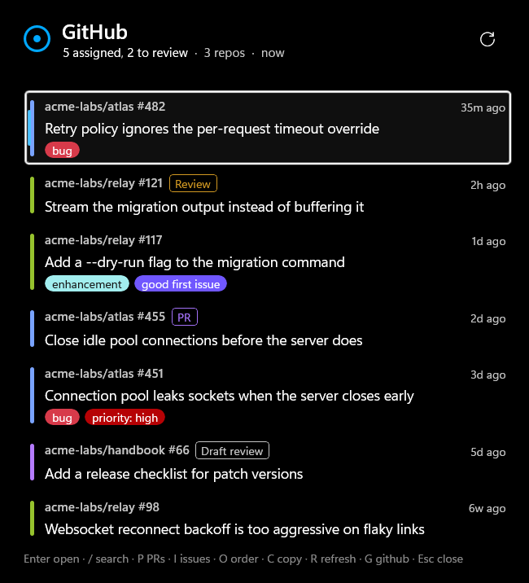

# GitHub Issues Tray

The GitHub issues and pull requests assigned to you, counted in the Windows tray.

A Windows port of the [omarchy-issues](https://ericksasse.com/omarchy-issues/) plugin:
the tray icon shows how many open issues and pull requests are assigned to you — plus
the pull requests waiting on your review — one click opens the list, and clicking an
item opens it in your browser.



## How it works

- **No token of its own.** Authentication is delegated to the
  [GitHub CLI](https://cli.github.com/): the app runs `gh search issues --assignee @me`,
  `gh search prs --assignee @me` and `gh search prs --review-requested @me` with the
  credentials already in `gh auth status`. Nothing is stored here.
- **No server in between.** It talks straight to the GitHub API, through `gh`.
- **WinUI 3 + C#.** The list is a Windows 11 flyout (acrylic, rounded corners, light or
  dark with the system). The tray icon is plain `Shell_NotifyIcon`: WinUI has no tray
  icon of its own, and going to Win32 directly costs a hundred lines and no dependency.
- The tray icon is drawn at runtime, with the count inside it. It has five states:
  three dots while the first query is still out, blue with the count, grey with the
  count when a refresh failed but the cached list is still worth showing, grey `0`
  when you are genuinely clear, and red `!` only when there is nothing to show and
  something is wrong.

Up to version 1 this was a PowerShell + WinForms script. The WinUI version reads the
same configuration, cache and list order, so upgrading keeps all three.

## Requirements

- Windows 10 (19041) or 11, x64 or ARM64
- [GitHub CLI](https://cli.github.com/), signed in — `winget install GitHub.cli` then `gh auth login`
- [.NET 10 SDK](https://dotnet.microsoft.com/download) to build — `winget install Microsoft.DotNet.SDK.10`.
  The Windows App SDK is bundled into the output; nothing else to install.

## Install

```powershell
git clone https://github.com/esasse/github-issues-tray.git
cd github-issues-tray
powershell -ExecutionPolicy Bypass -File .\build.ps1
powershell -ExecutionPolicy Bypass -File .\Install-Autostart.ps1
```

`build.ps1` publishes the app into `dist\` (stopping a running copy first, since Windows
locks the files of a running `.exe`). `Install-Autostart.ps1` creates a shortcut in your
Startup folder — no UAC, no scheduled task — starts the app, and pins its icon to the
taskbar instead of the `^` overflow menu, where Windows 11 puts every new tray icon.

Coming from the PowerShell version, run the same two commands: the shortcut has the same
name and now points at the `.exe`, and the old script is stopped if it is running.

To uninstall: `powershell -ExecutionPolicy Bypass -File .\Install-Autostart.ps1 -Remove`

## Use

**Tray icon**

| Action | Result |
|---|---|
| Left click | open/close the list |
| Middle click | open the most recently updated item |
| Right click | menu (refresh, sign in, configuration, log, quit) |
| `Ctrl+Win+I` | open/close the list from anywhere |

Launching the app again while it runs opens its list instead of a second copy.

**Inside the list**

| Key | Action |
|---|---|
| `↑` `↓` | move |
| `Enter` or left click | open the issue in the browser |
| `/` or `Ctrl+F` | search |
| `P` / `I` | show only pull requests / only issues, or everything again |
| `O` | switch between newest and oldest first |
| `C` or middle click | copy the link |
| `R` | refresh now |
| `G` | open github.com/issues/assigned |
| `L` | run `gh auth login` |
| `Esc` | clear the search, the header filter or `P`/`I`, or close |

Each row shows a colour bar for the repository (derived from its name, so it is stable
across runs), `owner/repo #number`, the title, the labels in their real GitHub colours,
and how long ago the issue was updated. Hovering a row shows its link.

**Order**

The list is sorted by last update, newest first. `O` flips it to oldest first, the
header says `oldest first` while it is on, and pressing `O` again flips it back. Unlike
the filters below, the order hides nothing, so it is remembered — across popups and
restarts. It only changes the order: `maxItems` still keeps the most recently updated
items, and a middle click on the tray icon still opens the newest one.

**Review requests**

Open pull requests that ask for your review — directly or through a team you are on,
the same set as github.com/pulls/review-requested — are in the list and in the tray
count, marked with an amber `Review` chip (`Draft review` while the PR is still a
draft, like every draft chip). A PR drops out on its own once you submit your review. A PR
that is assigned to you and also asks for your review is listed once, as a review.
The header and the tooltip count the two apart (`5 assigned, 2 to review · 4 repos`).

With both groups there, click either count in the header to list only that group; the
active one is underlined.
Click it again, or press `Esc`, to show everything. Like the search, it narrows the list
and nothing else, and it is forgotten when the popup closes.

`P` lists only pull requests — the assigned ones and the ones to review — and `I` only
issues; the header says `PRs only` or `Issues only` while one is on. Pressing the other
key switches straight over. Either combines with the header groups, so `P` plus a click
on `assigned` leaves the PRs assigned to you (`I` plus `to review` is always empty:
review requests are all pull requests). Press the same key again to show everything, or
`Esc` once the search and the header group are cleared; like the groups, it is forgotten
when the popup closes. Unlike typing `pr` in the search, `P` does not also catch titles
that happen to contain those letters.

**Search**

`/` or `Ctrl+F` opens a box under the header and the list narrows as you type. A term
matches anywhere in the title, the repository, the number or a label name, case
insensitive, so `4814`, `#4814`, `monde/api` and `bug` all work. Several terms are
ANDed and their order does not matter: `web mig` keeps only the rows that match both.
Pull requests also answer to `pr` and `draft`, and review requests to `review`.

`↑` `↓` and `Enter` keep working while you type, so you never have to leave the box to
reach the row you were looking for. The header counts what survived the filter
(`3 matching`). `Esc` clears the search and leaves the list open; a second `Esc` closes
the popup.

The filter is a view over the list and nothing else. The tray count and the tooltip go
on answering “how much is assigned to me”, because that is the number the icon exists
for, and the search is forgotten when the popup closes — reopening it to a silent
subset would be worse than typing the two letters again.

## Configuration

`%LOCALAPPDATA%\github-issues-tray\config.json`, created on first run (from the
PowerShell version's `config.json` at the repository root, when there is one). *Edit
configuration* in the tray menu opens it; *Reload configuration* applies it.

```json
{
  "refreshMinutes": 5,
  "maxItems": 50,
  "includeReviewRequests": true,
  "showLabels": true,
  "hotkey": "Ctrl+Win+I",
  "accentColor": "#00A8FF",
  "popupWidth": 520,
  "popupMaxHeight": 620
}
```

`includeReviewRequests: false` takes review requests out of the list and the count,
and stops asking GitHub for them. `accentColor` is the tray icon's colour.
`popupWidth` and `popupMaxHeight` are in DIPs, so they scale with the display.

### About the global hotkey

The default is `Ctrl+Win+I` rather than the original plugin's `Ctrl+Win+N`, because on
Windows 11 `Win+Ctrl+N` already belongs to Narrator. It accepts `Ctrl`, `Alt`, `Shift`,
`Win` (or `Super`) and a letter, digit or `F1`–`F24`; an empty string turns it off. If
the chosen combination is already taken by another program, the app notes it in the
log and starts normally, just without the hotkey.

## Where things live

`%LOCALAPPDATA%\github-issues-tray\`

| File | Contents |
|---|---|
| `config.json` | settings |
| `cache.json` | the last query — what shows up before the first one finishes |
| `prefs.json` | the list order (`O`) |
| `tray.log` | log (rotates at 256 KB) |

The Startup shortcut is in `%APPDATA%\Microsoft\Windows\Start Menu\Programs\Startup`.

For trying things without touching any of that, set `GITHUB_ISSUES_TRAY_HOME` to another
folder: the app keeps its state there and runs as a separate instance, next to the real
one. `--offline` never runs `gh` and shows whatever `cache.json` holds, which is how the
screenshot above is made, from made-up data. `--show` opens the list on start.

## When a refresh fails

A failed refresh does not throw away what the app already has. The count stays in the
tray, greyed out instead of blue, the popup says `Could not refresh` with the reason, and
the list keeps showing the last good data with its real age. The red `!` icon is only
for when there is genuinely nothing to show.

Before the first query comes back there is no count to show yet, and `0` would be a
lie, so the icon shows three dots instead. That is the only moment it does: during a
later refresh the number already on screen is truer than a spinner.

Failures retry on their own after 20s, 60s, 120s and 300s before falling back to the
normal interval, and the app watches its own clock: if the wall clock jumps by more
than three minutes, the machine was suspended, so it refreshes immediately instead of
waiting for the next tick. Between them, those two cover the common case by far — a
laptop waking up with the network a few seconds behind it. A query that takes more
than 60 seconds is killed and counts as a failure.

## Implementation notes

Things that are not obvious and that break if changed carelessly:

1. **`dotnet publish` leaves out the app's `.pri` and `.xbf` files** for an unpackaged
   WinUI app, although the build writes them, and the published `.exe` then dies in
   `InitializeComponent` with *XAML parsing failed*. A target in the `.csproj` copies
   them; do not remove it.
2. **The tray window is a hidden top-level window, not message-only.** Message-only
   windows do not get broadcasts, and `TaskbarCreated` is how the icon comes back after
   Explorer restarts.
3. **The tooltip limit is 127 characters** with `Shell_NotifyIcon`. WinForms'
   `NotifyIcon`, which the PowerShell version used, throws at 64 — and from a timer
   callback that became a modal .NET crash dialog. With `NOTIFYICON_VERSION_4` the
   standard tooltip only shows with `NIF_SHOWTIP`.
4. **`gh` runs with `GH_TELEMETRY=0`.** Since gh 2.92, a command sometimes hands its
   telemetry to a detached `gh` child, and that child runs `tzutil.exe`. Detached means
   no console to inherit, so `tzutil` gets one of its own — and with Windows Terminal
   as the default terminal that is a window flashing on screen for a split second,
   every so often, with nothing on it to tell where it came from. `CreateNoWindow` on
   our side does not reach that grandchild; turning telemetry off for the processes
   the app starts is what removes it.
5. **`/` is read as a character, with `handledEventsToo`.** The virtual key behind `/`
   moves with the keyboard layout (`VK_OEM_2` on US, `VK_ABNT_C1` on the Brazilian
   ABNT2), so it has to be the character. And with the focus on the list, the `ListView`
   marks that character handled: without `handledEventsToo` the search did not open,
   and the letters typed next ran as shortcuts.
6. **`TextBox.TextChanged` is asynchronous.** It arrives after the code that cleared the
   box has returned, so a "suppress while I set it" flag is already off by then. The
   search compares the box with the current filter instead.
7. **The list is focused through its selected row, not as a whole.** A `ListView` given
   the focus hands it to its first row, and the selection follows the focus, so the
   highlight jumped back to the top every time the search closed.

Fetching does not block the UI: the queries run in parallel child processes, both pipes
drained asynchronously (a full stderr pipe would otherwise hang a child still writing
stdout), and the result is applied on the UI thread.

## License

MIT
